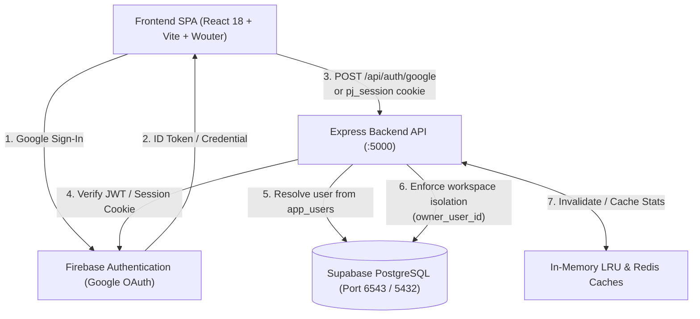
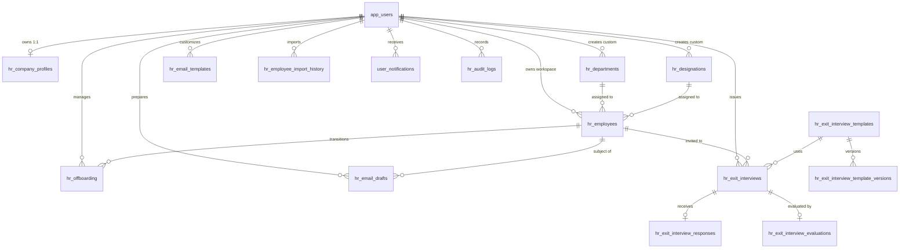
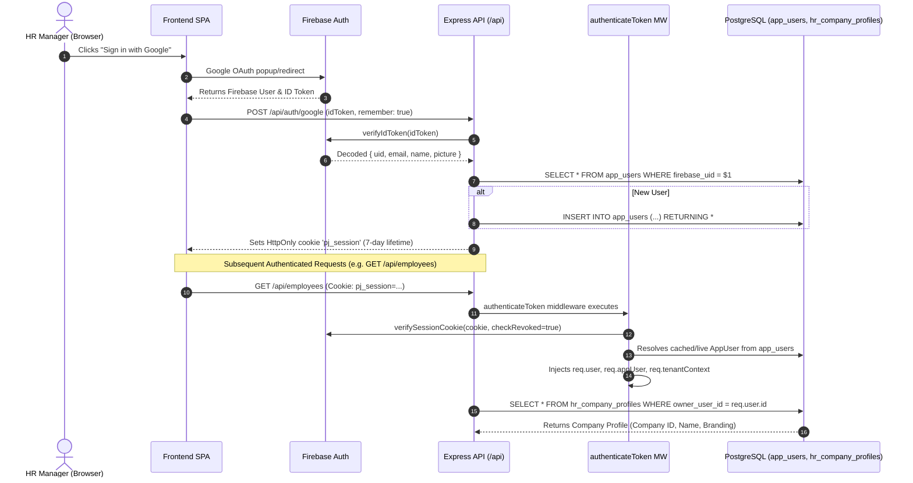
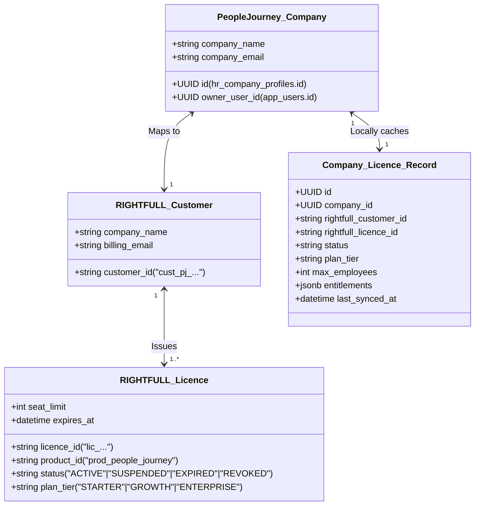
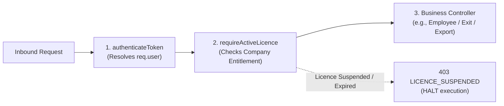
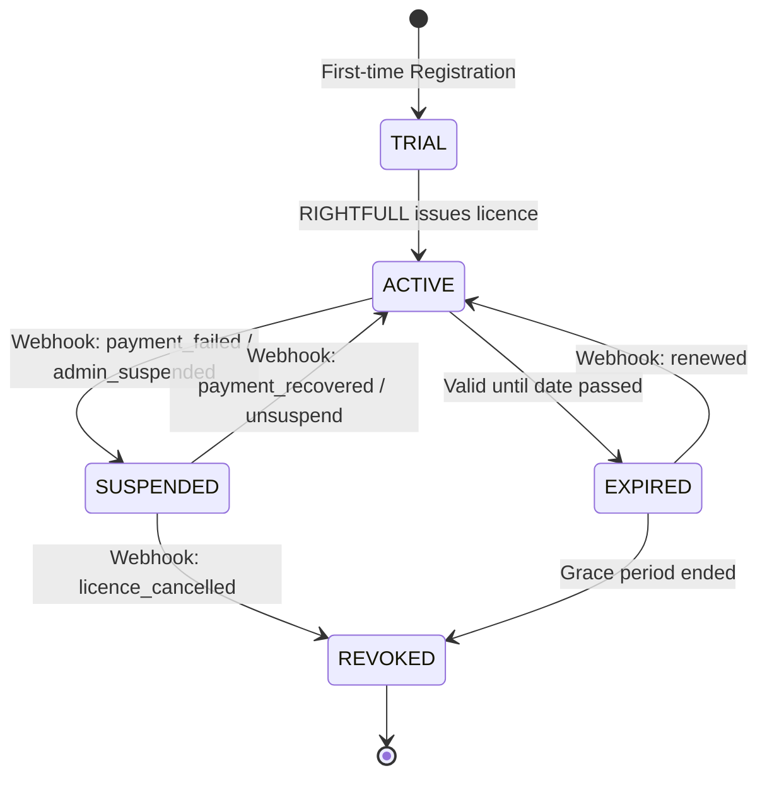

# RIGHTFULL Integration - Step 1: People Journey Architecture Audit

**Status:** Completed (Audit Only)  
**Date:** November 18, 2026  
**Auditor:** Senior Full-Stack & Application Security Engineering  
**Target Repository:** People Journey HR Portal (`People-Journey-HR-Portal`)  
**Production URL:** `https://people-journey-hr.onrender.com`  

---

## Executive Summary

This architecture audit evaluates People Journey's multi-tenancy, authentication, authorization, and data isolation models to design a clean, non-disruptive integration with **RIGHTFULL**, an external software licensing and entitlement management platform.

### Core Findings
1. **Tenancy Model:** People Journey implements a **Personal Workspace multi-tenant architecture**. Every authenticated user in `app_users` owns their personal workspace, anchored by their unique user UUID (`owner_user_id`).
2. **Company Entity:** The legal/commercial entity is represented by `hr_company_profiles` (`id UUID PRIMARY KEY`, `owner_user_id UUID NOT NULL UNIQUE REFERENCES app_users(id)`). The company profile is currently strictly 1:1 with the workspace owner.
3. **Licensing State:** There are **zero existing subscription, billing, plan, or license tables** in the database.
4. **Independent Company Licensing Feasibility:** **Fully Supported.** Because each company's workspace resources (`hr_employees`, `hr_offboarding`, `hr_exit_interviews`, `hr_company_profiles`, `hr_employee_import_history`) are strictly isolated by `owner_user_id` / company profile, RIGHTFULL can issue, suspend, or revoke a license for one company with **zero impact** on any other company.
5. **Architectural Gap to Consider:** If future business requirements demand that multiple distinct user accounts (e.g. HR Staff, Recruiters, Line Managers) join and collaborate within the *same* company workspace under a single shared company license, an explicit organization membership model (`company_members`) will be required. For individual company accounts/HR owners, the current architecture supports independent licensing immediately.

---

## Section A: Existing Architecture Overview

People Journey is a full-stack HR lifecycle and employee transition management application.



### 1. Technology Stack
- **Frontend:** React 18, TypeScript, Vite, Wouter routing, TanStack React Query v5, Tailwind CSS, Radix UI.
- **Backend:** Node.js, Express (ES Modules), TypeScript (`tsc` with `tsx` test execution), Pino logging, Helmet security headers, CORS with credential support.
- **Database:** Supabase managed PostgreSQL with PgBouncer connection pooling:
  - Application runtime pool: Port 6543 (Transaction-mode pooler via `DATABASE_URL`).
  - Migration / DDL pool: Port 5432 (Session-mode pooler via `DIRECT_URL`).
- **Authentication:** Firebase Authentication (Google OAuth provider) with Firebase Admin SDK server verification. Sessions are maintained via 7-day HttpOnly `pj_session` cookies with fallback to `Authorization: Bearer <idToken>`.
- **Tenant Isolation:** Hybrid application-level workspace partitioning (`WHERE owner_user_id = $1`) and PostgreSQL transaction-scoped context (`app.current_user_id()`, `app.current_company_id()`, `app.current_user_role()`).
- **External Integrations:** Firebase Auth, Google Forms webhook (`/api/exit-interviews`), Render hosting, optional Redis cache/rate limiter.

---

## Section B: Company & Workspace Data Model

### 1. Actual Database Tables Found

The database schema (migrations 001 through 011) consists of **17 tables**:

| Table Name | Primary Key | Workspace/Owner Key | Purpose |
| :--- | :--- | :--- | :--- |
| `schema_migrations` | `version VARCHAR(100)` | None | Tracks applied migration versions. |
| `app_users` | `id UUID` | Self (`id`) | Registered user accounts mapped from Firebase UIDs. |
| `hr_company_profiles` | `id UUID` | `owner_user_id UUID UNIQUE` | Company branding, legal details, HR contacts, onboarding step. |
| `hr_employees` | `employee_id SERIAL` | `owner_user_id UUID` | Employee roster records (`uuid UUID UNIQUE`, `employee_code`). |
| `hr_offboarding` | `offboarding_id SERIAL` | `owner_user_id UUID` | Offboarding workflows, exit dates, clearance status. |
| `hr_departments` | `department_id SERIAL` | `owner_user_id UUID` (Nullable) | Department directory (NULL = system starter, non-NULL = custom). |
| `hr_designations` | `designation_id SERIAL` | `owner_user_id UUID` (Nullable) | Job roles/designations (NULL = system starter, non-NULL = custom). |
| `hr_email_templates` | `id UUID` | `owner_user_id UUID` (Nullable) | Communication templates (NULL = starter, non-NULL = custom). |
| `hr_email_drafts` | `id UUID` | `owner_user_id UUID` | User-scoped generated draft snapshots and Gmail click states. |
| `hr_exit_interview_templates` | `id UUID` | `owner_user_id UUID` (Nullable) | Exit interview forms (NULL = default master, non-NULL = custom). |
| `hr_exit_interview_template_versions` | `id UUID` | Via `template_id` | Immutable published snapshots of exit interview form structures. |
| `hr_exit_interviews` | `id UUID` | `owner_user_id UUID` | Exit interview invitations, access tokens, and status. |
| `hr_exit_interview_responses` | `id UUID` | Via `interview_id` | Submitted exit interview candidate feedback answers. |
| `hr_exit_interview_evaluations` | `id UUID` | Via `interview_id` | Internal HR review ratings, retention flags, and interviewer notes. |
| `hr_employee_import_history` | `id UUID` | `owner_user_id UUID` | Audit history and column mappings for Excel import jobs. |
| `user_notifications` | `id SERIAL` | `user_id UUID` | In-app user notifications and lifecycle alert touches. |
| `hr_audit_logs` | `log_id SERIAL` | `user_id UUID` | Immutable audit trail of operational changes. |

### 2. Entity-Relationship Diagram



### 3. Subscription & Billing Tables
- **None exist.** No subscription, licensing, quota, plan, billing, or entitlement tables exist in any migration.

---

## Section C: How a Logged-in User is Associated with a Company

The association between an authenticated user and their company workspace follows this deterministic pipeline:



### Key Technical Properties
1. **User Identity Anchor:** `req.user.id` (UUID) from `app_users`.
2. **Company Identity Anchor:** `hr_company_profiles.id` (UUID), linked via `hr_company_profiles.owner_user_id = req.user.id`.
3. **Workspace Scope Resolution:** All downstream queries automatically scope their operations by `owner_user_id = req.user.id`. For example:
   ```typescript
   // employee.service.ts
   SELECT * FROM hr_employees WHERE owner_user_id = $1 AND deleted_at IS NULL;
   ```
4. **Current Workspace Determination:** The workspace is **implicit**. Because each user has exactly one personal HR workspace, there is no workspace selector header, cookie, or switcher. The authenticated user's ID *is* the workspace key.

---

## Section D: Feasibility of Company-Level Licence Assignment

### Current Architecture Assessment
| Capability | Supported Today? | Architectural Details |
| :--- | :---: | :--- |
| **Independent Company Licensing** | **YES** | Each user/company is strictly isolated by `owner_user_id`. Suspending Company A's license blocks Company A's queries without touching Company B. |
| **Licence Scoping to Company Profile** | **YES** | Can bind a RIGHTFULL licence to `hr_company_profiles.id` (or `owner_user_id`). |
| **Feature Gating by Tier** | **READY** | Can enforce tier limits (e.g., maximum employees, Excel bulk import access, export privileges, custom exit templates) in middleware. |
| **Multiple Users Sharing One Licence** | **REQUIRES STEP 2 WORK** | Currently, if User 1 and User 2 both log in, they create two distinct companies. There is no `company_members` table allowing User 2 to join User 1's company. |
| **One User Managing Multiple Companies** | **REQUIRES STEP 2 WORK** | `hr_company_profiles.owner_user_id` has a `UNIQUE` constraint, enforcing 1 user = 1 company. |

---

## Section E: Recommended Entity Mapping (People Journey <-> RIGHTFULL)

To integrate RIGHTFULL cleanly with zero schema conflicts, the following mapping is recommended:



### Detailed Mapping Table

| People Journey Entity / Field | RIGHTFULL Attribute | Recommended Format / Convention | Purpose |
| :--- | :--- | :--- | :--- |
| `hr_company_profiles.id` (UUID) | **Customer External ID** / **Account Reference** | `pj_comp_<UUID>` | Stable foreign key tying RIGHTFULL customer to People Journey company. |
| `app_users.email` / `company_email` | **Customer Billing Email** | Email string | Communication, invoicing, and administrator alerts. |
| `hr_company_profiles.company_name` | **Customer Name** | String | Business entity display in RIGHTFULL dashboard. |
| *New: `company_licences.rightfull_licence_id`* | **Licence ID** | String (`lic_...`) | The unique license instance issued by RIGHTFULL. |
| *New: `company_licences.product_id`* | **Product ID** | `people_journey_core` | The RIGHTFULL product catalog item. |
| *New: `company_licences.plan_tier`* | **Plan / SKU Tier** | `starter`, `growth`, `enterprise` | Controls feature gates (e.g. employee quotas, Excel smart import, CSV export). |
| *New: `company_licences.status`* | **Licence Status** | `active`, `suspended`, `expired`, `revoked` | Authorization gate status in Express middleware. |

---

## Section F: Recommended Secure Location for RIGHTFULL Credentials

All integration secrets must adhere to People Journey's strict production security model:

```
[RIGHTFULL API Cloud] 
       │ 
       ▼ (HTTPS TLS 1.3 + Secret Verification)
[Render / Production Secrets Management]
       │
       ▼ (Injected at Runtime)
[backend/src/config/env.ts]
       │
       ▼ (Loaded into Memory Only)
[RightfullClient / WebhookVerifier]
```

### 1. Required Integration Variables
The following environment variables should be provisioned in the production environment (e.g., Render Dashboard Environment Settings) and declared in `backend/src/config/env.ts`:

- `RIGHTFULL_API_BASE_URL`: Base URL for the RIGHTFULL API (e.g., `https://api.rightfull.io/v1`).
- `RIGHTFULL_API_KEY`: Secret API key used by People Journey backend to communicate with RIGHTFULL (Bearer token).
- `RIGHTFULL_WEBHOOK_SECRET`: Cryptographic shared secret used to verify HMAC-SHA256 signatures on inbound webhooks from RIGHTFULL.
- `RIGHTFULL_PRODUCT_ID`: Identifier for People Journey within RIGHTFULL's catalog.
- `RIGHTFULL_CACHE_TTL_SECONDS`: Local in-memory license status cache TTL (recommended: `300` seconds / 5 minutes to prevent redundant API latency).

### 2. Security Restrictions
- **Zero Client Exposure:** These credentials must **never** be prefixed with `VITE_` or exposed to the frontend bundle.
- **Zero Logging:** Must be excluded from Pino logs and masked in error stack traces.
- **Local Development:** Maintained solely in `.env` (which is strictly included in `.gitignore`).

---

## Section G: Recommended Backend Middleware Integration Points

### 1. Middleware Chain & Placement

License validation must occur **after** user authentication (`authenticateToken`), but **before** business controllers:



### 2. Recommended Middleware Location in Codebase
- Path: `backend/src/middleware/licence.middleware.ts`
- Functions:
  - `requireActiveLicence(req, res, next)`: Validates that the company profile associated with `req.user.id` has an `ACTIVE` license in cache/database. If suspended/expired, halts with HTTP 403.
  - `requireFeatureEntitlement(featureKey: string)`: Higher-order middleware for granular features (e.g. `EXCEL_SMART_IMPORT`, `BULK_EXPORT`, `CUSTOM_EXIT_TEMPLATES`).

### 3. API Restriction Matrix

When a company's license is **Suspended** or **Revoked**, the following endpoints must be restricted or exempted:

| API Route | Authenticated? | Action When Licence Suspended | Rationale |
| :--- | :---: | :---: | :--- |
| **`/health` & `/healthz`** | No | **ALLOW** | Cloud infrastructure and deployment health checks must never fail. |
| **`/api/auth/session`** | Yes | **ALLOW** | User must still be able to read their session state and see their license status. |
| **`/api/auth/logout`** | Yes | **ALLOW** | User must always be permitted to terminate their session. |
| **`/api/company-profile` (GET)** | Yes | **ALLOW** | User must be able to view their company profile and licensing error details. |
| **`/api/employees/*`** | Yes | **BLOCK (403)** | Core HR operations must be halted for non-licensed companies. |
| **`/api/employees/import/*`**| Yes | **BLOCK (403)** | Resource-heavy Excel imports blocked. |
| **`/api/exit-interviews` (HR)**| Yes | **BLOCK (403)** | HR management, creation, and evaluation blocked. |
| **`/api/dashboard/*`** | Yes | **BLOCK (403)** | Overview metrics and workspace reports blocked. |
| **`/api/email-templates/*`** | Yes | **BLOCK (403)** | Communication workflows blocked. |
| **`/e/:code` & `/submit/:code`**| No | **ALLOW or GRACEFUL** | Public candidate exit surveys already in flight to departing employees should either be accepted or display a branded graceful notice, without exposing internal errors. |
| **`/api/webhooks/rightfull`** | Webhook Sig | **ALLOW** | Inbound webhooks from RIGHTFULL to unsuspend or update licenses must always succeed. |

---

## Section H: Risks, Missing Functionality, and Prerequisites

### 1. Identified Risks
1. **Network Latency & Rightfull Availability:** If People Journey calls the RIGHTFULL API synchronously on every HTTP request, a network hiccup or RIGHTFULL outage would take down People Journey.
   - *Mitigation:* Implement **local caching with a dedicated database table** (`company_licences`). Validate license status against the local PostgreSQL record / Redis cache; update via asynchronous webhooks or background sync.
2. **Missing Company Profile Edge Case:** When a user signs in for the very first time via Google OAuth, `app_users` is created immediately, but `hr_company_profiles` is created later when the user completes onboarding Step 1.
   - *Mitigation:* The license middleware must recognize newly registered users in the "onboarding" state and allow them access to company profile setup endpoints before enforcing active license checks.
3. **Public Exit Interview Links:** Departing employees access `/e/:code` without logging in. If their company's license is suspended:
   - Should departing candidates still be allowed to submit exit interviews?
   - *Recommendation:* Allow candidate submissions for already-issued invitations, but block HR managers from creating new ones.

### 2. Prerequisites for Step 2 (Implementation)
1. Migration to create a local `company_licences` table caching license status, seat counts, and plan details.
2. Dedicated webhook handler `POST /api/webhooks/rightfull` with HMAC-SHA256 signature verification.
3. Rightfull SDK / HTTP client service (`rightfull.service.ts`) with retry and timeout policies.
4. License status middleware (`licence.middleware.ts`).
5. Frontend banner / alert indicating license suspension with renewal action links.

---

## Section I: Proposed Architecture for Independent Company Suspension & Revocation

To ensure that suspending Company A has zero effect on Company B, the licensing system must be strictly decoupled per company:



### 1. Proposed Local Cache Schema (`company_licences`)
```sql
CREATE TABLE IF NOT EXISTS company_licences (
    id UUID PRIMARY KEY DEFAULT gen_random_uuid(),
    company_id UUID NOT NULL UNIQUE REFERENCES hr_company_profiles(id) ON DELETE CASCADE,
    owner_user_id UUID NOT NULL REFERENCES app_users(id) ON DELETE CASCADE,
    rightfull_customer_id VARCHAR(128) NOT NULL,
    rightfull_licence_id VARCHAR(128) NOT NULL UNIQUE,
    product_id VARCHAR(100) NOT NULL DEFAULT 'people_journey_core',
    status VARCHAR(50) NOT NULL DEFAULT 'active' 
        CHECK (status IN ('active', 'suspended', 'expired', 'revoked', 'trial')),
    plan_tier VARCHAR(50) NOT NULL DEFAULT 'standard',
    max_employees INTEGER NOT NULL DEFAULT 50,
    entitlements JSONB NOT NULL DEFAULT '{"bulk_import": true, "export_reports": true}'::jsonb,
    valid_until TIMESTAMPTZ,
    grace_period_ends_at TIMESTAMPTZ,
    last_verified_at TIMESTAMPTZ NOT NULL DEFAULT CURRENT_TIMESTAMP,
    created_at TIMESTAMPTZ NOT NULL DEFAULT CURRENT_TIMESTAMP,
    updated_at TIMESTAMPTZ NOT NULL DEFAULT CURRENT_TIMESTAMP
);

CREATE INDEX IF NOT EXISTS idx_company_licences_company ON company_licences(company_id);
CREATE INDEX IF NOT EXISTS idx_company_licences_owner ON company_licences(owner_user_id);
CREATE INDEX IF NOT EXISTS idx_company_licences_status ON company_licences(status);
```

### 2. Suspension Workflow (Step-by-Step)
1. **Trigger:** RIGHTFULL sends an event (e.g. `licence.suspended` or `licence.revoked`) to `POST /api/webhooks/rightfull`.
2. **Signature Verification:** Express verifies `X-Rightfull-Signature` against `RIGHTFULL_WEBHOOK_SECRET`.
3. **Targeted DB Update:**
   ```sql
   UPDATE company_licences 
   SET status = 'suspended', updated_at = CURRENT_TIMESTAMP 
   WHERE rightfull_licence_id = $1;
   ```
4. **Cache Invalidation:** The specific company's cache key (`licence:comp_<company_id>`) is invalidated. Company B's cache is completely untouched.
5. **Immediate Enforcement:**
   - The next request from Company A's HR Manager hits `requireActiveLicence`.
   - The middleware checks `company_licences.status` -> finds `suspended`.
   - The request is immediately rejected with:
     ```json
     {
       "success": false,
       "error": {
         "code": "LICENCE_SUSPENDED",
         "message": "Your organization's People Journey licence is currently suspended. Please contact your billing administrator."
       }
     }
     ```
   - Company B's users continue to access People Journey with zero disruption.

---

## Conclusion & Readiness for Step 2

The People Journey architecture is well-prepared for RIGHTFULL integration. Its existing strict workspace isolation (`owner_user_id` / `hr_company_profiles`) provides a natural boundary for multi-tenant licensing. By implementing a cached local license record and webhook synchronization, RIGHTFULL licenses can be issued, verified, and revoked independently with high performance, resilience against external API outages, and strict security.
